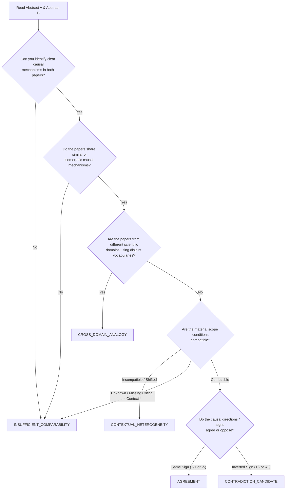

# Annotation Guide & Rubric: 4-Stratum Benchmark for Causal Alignment (CCST)

**Course:** SWM Group Project  
**Author/Coordinator:** Vedang Vasant Avaghade  
**Target:** 240 Evaluated Scientific Claim Pairs across 4 Strata  

---

## 1. Overview of Task

The objective of annotation is **not** to determine whether a scientific paper is objectively true or whether a medical drug is FDA-approved. Rather, your task is to compare the **reported causal claims** of Paper A ($d_i$) and Paper B ($d_j$) and assign exactly **one** of the five mutually exclusive relations:

1. `AGREEMENT`
2. `CROSS_DOMAIN_ANALOGY`
3. `CONTRADICTION_CANDIDATE`
4. `CONTEXTUAL_HETEROGENEITY`
5. `INSUFFICIENT_COMPARABILITY` (Abstention)

---

## 2. Decision Tree for Human Annotators

Follow this sequence of tests strictly:

---

## 3. Detailed Definitions & Exemplars

### 1. `AGREEMENT`
* **Definition:** Both papers report the same causal mechanism ($A \to M \to Y$), with the same causal polarity ($\delta_A = \delta_B$), under materially compatible experimental conditions ($C_A \approx C_B, P_A \approx P_B$).
* **Example:**
  * *Paper A:* "Atorvastatin 40mg reduced LDL-C in adult cardiac patients." ($\delta = -1$)
  * *Paper B:* "Atorvastatin therapy significantly decreased serum cholesterol levels in hypertensive adults." ($\delta = -1$)
* **Decision:** `AGREEMENT`.

### 2. `CROSS_DOMAIN_ANALOGY`
* **Definition:** The two papers are from **different scientific disciplines** (e.g. biomedicine vs computer networks, or control systems vs immunology) and use completely different vocabularies, but their underlying **causal graph structure is isomorphic**.
* **Example:**
  * *Paper A (Epidemiology):* "Quarantine of high-degree contact network nodes suppressed airborne virus transmission velocity."
  * *Paper B (Computer Security):* "Dynamic isolation of high-centrality router nodes prevented self-replicating worm malware spread."
* **Decision:** `CROSS_DOMAIN_ANALOGY`.

### 3. `CONTRADICTION_CANDIDATE`
* **Definition:** Both papers evaluate the same or equivalent intervention on the same population under **compatible material conditions**, but report **opposing causal directions** (one finds positive effect $\delta = +1$, the other finds negative $\delta = -1$ or zero).
* **Important:** We use the term *"Candidate"* because structural contradiction in literature does not establish who is right.
* **Example:**
  * *Paper A:* "In a randomized trial of adult hypertensive patients, Amlodipine 10mg daily significantly reduced mean systolic blood pressure."
  * *Paper B:* "In a randomized trial of adult hypertensive patients, Amlodipine 10mg daily failed to lower blood pressure and caused significant blood pressure elevation."
* **Decision:** `CONTRADICTION_CANDIDATE`.

### 4. `CONTEXTUAL_HETEROGENEITY`
* **Definition:** The two papers report divergent or opposing findings, but the disagreement is **explained by a shift in material scope conditions** (species, dosage scale, environmental assay, time horizon).
* **Example:**
  * *Paper A:* "Amlodipine 5mg oral daily lowers blood pressure in hypertensive humans." (Therapeutic low dose, human in vivo).
  * *Paper B:* "Amlodipine 100mg/kg triggers paradoxical reflex hypertension in mice." (Supra-toxic dose, murine in vivo).
* **Decision:** `CONTEXTUAL_HETEROGENEITY`.

### 5. `INSUFFICIENT_COMPARABILITY`
* **Definition:** The papers cannot be reliably aligned or compared because:
  * One or both papers omit critical material conditions (e.g., dosage or assay method omitted).
  * The extraction has high uncertainty ($u > 0.4$).
  * The mechanisms do not correspond.
* **Decision:** `INSUFFICIENT_COMPARABILITY`.

---

## 4. Multi-Annotator Protocol & Krippendorff's $\alpha$

1. Each natural pair (Strata 2, 3, and 4) must be independently reviewed by **at least 3 annotators**.
2. Annotators record their vote without discussing with other members.
3. Pre-adjudication agreement is computed using **Krippendorff's $\alpha$ (nominal metric)**:
   $$\alpha = 1 - \frac{D_o}{D_e}$$
   * Target: $\alpha \ge 0.70$ across natural pairs.
4. If annotators disagree, the case is flagged for group adjudication to produce the final consensus label (`adjudicated = True`).
